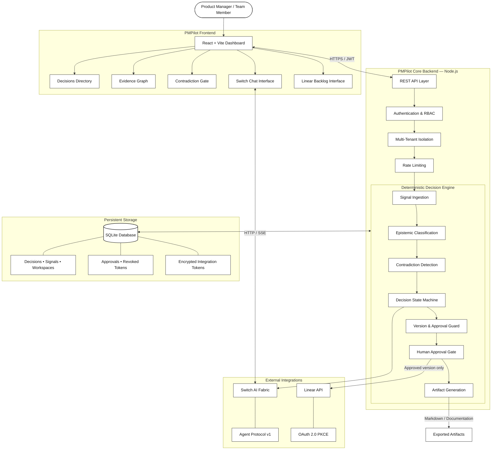

# PMPilot - Decision Intelligence for Product Managers

**Turn fragmented product feedback into traceable, conflict-free, and execution-ready decisions.**

PMPilot is a decision-intelligence platform that helps product teams transform scattered customer feedback, bug reports, and product insights into structured, evidence-backed decisions.

Unlike generic AI assistants that generate recommendations without accountability, PMPilot introduces deterministic workflows, evidence provenance, contradiction detection, multi-agent collaboration, and human approval gates to ensure that every product decision is explainable, traceable, and authorized before reaching engineering.

---

## Live Demo

**Live Application:** 

**Source Code:** [PMPilot — GitHub Repository](https://github.com/rmanne24/prod-man-hunt)

---

## Problem Statement

Product managers make critical decisions using information scattered across customer conversations, feedback forms, analytics, support tickets, design documents, and issue trackers.

This creates several challenges:

- **Fragmented Evidence:** Important customer signals are distributed across disconnected tools and platforms.
- **Unverified AI Recommendations:** Generic AI tools generate recommendations without distinguishing facts from assumptions or providing reliable evidence provenance.
- **Conflicting Requirements:** Contradictory customer needs and product requirements often go unnoticed until implementation.
- **Uncontrolled Scope Changes:** AI-generated suggestions and stakeholder inputs can introduce unapproved changes into the development pipeline.
- **Lack of Accountability:** Teams lack a reliable mechanism to track who approved a decision and which exact version was authorized.

The result is misaligned teams, unreliable roadmaps, wasted engineering effort, and product decisions that are difficult to audit.

## Our Approach

PMPilot introduces a deterministic decision-intelligence workflow that connects evidence collection, AI collaboration, human judgment, and engineering execution.

### Core Capabilities

**1. Signal Capture**

Collect unstructured customer feedback, bug reports, and competitor observations and organize them into structured product signals.

**2. Epistemic Classification**

Every piece of evidence is classified into four categories:

- `OBSERVED` — Directly supported by available evidence.
- `INFERRED` — Derived through reasoning from existing evidence.
- `ASSUMED` — A proposition accepted without sufficient verification.
- `UNKNOWN` — Information that is currently unavailable or unresolved.

**3. Contradiction Detection**

Identify conflicting requirements and evidence before they influence downstream decisions. Unresolved contradictions block the approval and delivery workflow.

**4. Multi-Agent Collaboration**

Integrate Switch AI to create decision-specific collaboration rooms where humans and AI agents can discuss evidence, evaluate alternatives, and submit structured change proposals.

**5. Human Approval Gate**

Require explicit approval from a verified Product Manager for a specific decision version. Any material modification invalidates previous approval and requires a fresh sign-off.

**6. Controlled Engineering Delivery**

Export approved product decisions into Linear as synchronized backlog issues. Generate decision documentation in Markdown for further collaboration and documentation workflows.

**7. Multi-Tenant Workspaces**

Maintain isolated workspaces with owner and member access controls, ensuring that teams can securely manage their own product decisions and evidence.

---

## 3. System Architecture

PMPilot follows a modular architecture consisting of a React frontend, a Node.js backend, a deterministic decision engine, persistent storage, and external integrations.




### The Decision Lifecycle

Every product decision follows a controlled lifecycle:

`DRAFT → CONFLICT_REVIEW → RECOMMENDATION_READY → AWAITING_APPROVAL → APPROVED → ARTIFACT_GENERATED`

A critical design principle is **version-bound approval**.

Every material decision modification increments its version and invalidates previous approvals. This prevents outdated or modified recommendations from silently entering the engineering backlog.

---

## Technology Stack

| Layer | Technologies |
|---|---|
| Frontend | React, Vite |
| Backend | Node.js |
| Database | SQLite |
| Authentication | JWT, PBKDF2, SHA-512 |
| Security | HMAC-SHA256, AES-256-GCM |
| AI Collaboration | Switch AI, Agent Protocol v1 |
| Issue Management | Linear API, OAuth 2.0 PKCE |
| Communication | HTTP, Server-Sent Events (SSE) |
| Deployment | Docker, Docker Compose |
| Testing | Automated Unit & Integration Tests |

## Coding Tools & Development Workflow

PMPilot was developed using AI-assisted engineering tools to accelerate implementation, integration, and iterative development.

- **OpenAI Codex:** Assisted with code generation, implementation, debugging, and development workflows.
- **Google Antigravity:** Used as an AI-powered development environment for building, iterating, and refining the application.

The development process focused on translating the product architecture into working application components, integrating external services, and validating critical workflows through automated tests.

## Local Setup & Installation

### Prerequisites

- Node.js v18 or later
- npm v9 or later
- Git
- Docker (optional)

### Clone the Repository

```bash
git clone https://github.com/rmanne24/prod-man-hunt.git

cd prod-man-hunt
```

### Install Dependencies

```bash
npm install

npm --prefix backend install

npm --prefix frontend install
```

### Configure Environment Variables

Copy the example environment file:

```bash
cp .env.production.example backend/.env
```

Generate secure random secrets:

```bash
node -e "console.log(require('crypto').randomBytes(32).toString('hex'))"
```

Configure the generated values in `backend/.env`:

```env
SESSION_SECRET=your_generated_secret
INTEGRATION_ENCRYPTION_KEY=your_generated_secret
```

Configure any additional integration credentials required by your environment.

### Start the Application

```bash
npm start
```

The application will be available at:

- Frontend: http://localhost:5173
- Backend: http://localhost:4000

### Docker Deployment

Alternatively, launch PMPilot and Switch Core using Docker Compose:

```bash
docker compose up -d --build
```

---

## Built For

PMPilot explores a more accountable approach to AI-assisted product management.

Our central principle:

**AI can propose. Evidence must justify. Humans must approve. Systems must enforce.**

PMPilot aims to make product decisions more transparent, collaborative, traceable, and reliable — from the first customer signal to the final engineering issue.

---

**Author:** Sairishita Manne

**License:** MIT
